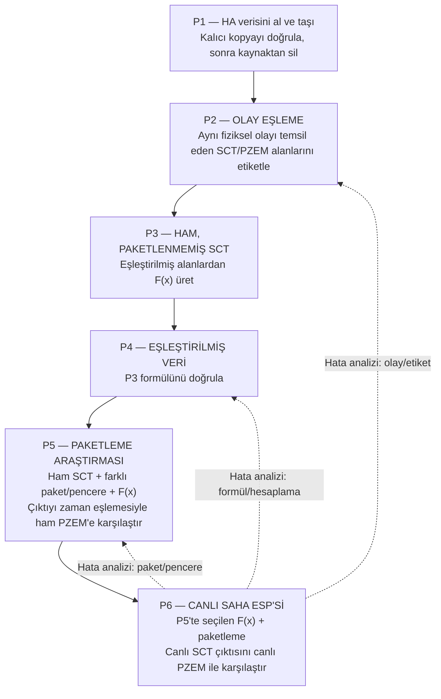

# HDF-002 — Ölçüm Karakterini Öğrenmek, Gerçek Dalgayı Yakalamak ve Akımı ESP'de Hesaplamak

**Durum:** Açık — hedef mimarisi ve çalışma zinciri tanımlanıyor; donanım kurulumunun, yeni deneylerin, model başarısının veya ±%4 doğruluğun tamamlandığı iddia edilmiyor.  
**Güncelleme:** 2026-10-12  
**Önceki hedef:** HDF-001 / GRV-001 geçmiş çalışmadır. Mevcut kodlar, loglar ve tecrübeler yeniden kullanılacak; eski kayıtlar silinmeyecek veya üzerine yazılmayacak.

## 1. Nihai hedef

BERO sahasına taşındığında amaç, **tek bir ESP'nin SCT + BIAS sinyalinden akımı gerçek zamanlı hesaplaması ve hesaplanan akımı Home Assistant'a/sisteme sunmasıdır.** Bu ESP, masaüstünde eğitilmiş ve doğrulanmış bir modelin küçük, sahada çalışabilir karşılığı gibi davranacaktır.

Ayrı Modbus PZEM donanımı ölçüm ve doğrulama referansı olarak kalır. Nihai SCT ESP'sinin PZEM'e sürekli bağımlı olması şart değildir. Gerilim (V) ve güç faktörü (PF) gibi PZEM verileri ancak modelin bağımsız testlerdeki başarımını anlamlı ölçüde iyileştirdiği gösterilirse modele girdi olarak eklenir. Öncelik, SCT + BIAS ile yeterli başarımı sağlayan en sade modeldir.

**Pratik hedef:** PZEM referansına göre yaklaşık ±%4 bağıl akım hatasına ulaşmayı araştırmak. Bu bir hedef olup doğrulanmış sonuç değildir. Sıfıra yakın akımda bağıl hata tek başına uygun olmadığından mutlak amper hatası da raporlanır.

## 2. Mimari — ayrı görevler, ayrı beslemeler

Planlanan ilk altyapı beş ESP işlevinden oluşur:

1. **SCT ölçüm ESP #1:** 1T SCT + kendisine ait BIAS ölçümü.
2. **SCT ölçüm ESP #2:** 2T SCT + kendisine ait BIAS ölçümü.
3. **SCT ölçüm ESP #3:** 3T yerine seçilecek/değiştirilecek SCT + kendisine ait BIAS ölçümü.
4. **PZEM ESP:** Ayrı Modbus PZEM donanımından ölçüm verilerini okur; akım, gerilim ve PF değerlerini HA'ya aktarır.
5. **Zamanlayıcı/kontrol ESP:** Solid-state röleyi belirlenen sabit aralıklarla açıp kapatır ve kontrol denemelerinin kayıtlarını tutar.

Bu beşli, başlangıç altyapısı ve veri üretme düzenidir. Nihai hedefin mutlaka beş ESP ile tamamlanması gerekmez; model geliştirme sırasında birden fazla SCT zinciri kullanılabilir, son saha çözümü için tek ölçüm ESP'si hedeflenir.

### 2.1 Besleme ve sinyal sınırı

- ESP'lerin beslemeleri ölçüm kanallarından beslenmeyecektir; ESP beslemesi ve analog ölçüm kanalı ayrı işlevlerdir.
- SCT/BIAS/ADC devresinin gerektirdiği sinyal referansı ve GND bağlantıları elektriksel tasarımda doğru biçimde kurulacaktır. Beslemeleri ayırmak, sinyal referansını gelişigüzel kaldırmak anlamına gelmez.
- PZEM kendi ayrı donanım ve okuma zincirinde kalır.
- Solid-state rölenin anahtarladığı devre ve elektriksel sınırlar fiziksel bağlantı aşamasında açıkça kaydedilir. Rölenin aç/kapa yapması ESP ölçüm zamanlamasının yerine geçmez; yalnızca planlanan kontrol/kayıt penceresini veya tasarımda belirlenen devreyi yönetir.
- Her donanım değişikliği, bağlantı koşulları ve ölçüm sonuçları tarihli deneme kaydıyla belgelenir.

## 3. Görev 1 — Fiziksel altyapı ve deneme kayıtları

İlk iş; üç SCT + BIAS ölçüm zincirini, ayrı PZEM okuma zincirini ve sabit aralıkla çalışan solid-state röle kontrolünü fiziksel olarak kurmak ve kayıt altına almaktır.

- Beslemeler ve sinyal bağlantıları ayrı ayrı kontrol edilir.
- Her ESP'nin hangi sensör/kanala bağlı olduğu açıkça kaydedilir.
- Kullanılan kod sürümü, derleme sonucu, gerçek cihaz logları, ölçülen değerler, hata ve değişiklikler deneme kaydına eklenir.
- Başarısız denemeler de saklanır; önceki çalışan kodun üzerine yazılmaz.
- Bu aşama tamamlandı diye dalga kalitesi veya akım doğruluğu varsayılmaz.

## 4. Görev 2 — En kaliteli SCT dalga okuma yöntemi

Amaç, yalnızca çok sayıda örnek üretmek değil, SCT dalgasının biçimini, genliğini ve değişimini doğru temsil eden kaliteli ham veri elde etmektir.

İncelenecek noktalar:

- Dalga biçimini ve tepe noktalarını temsil etmeye yeterli gerçek örnekleme hızı.
- Örnekler arası zaman aralığı ve zamanlama düzenliliği.
- ADC çözünürlüğü, gürültü, kırpılma/saturasyon ve analog giriş devresinin etkisi.
- SCT ile BIAS verisinin ilişkisinin korunması.
- Wi-Fi/HA aktarımının örnekleme döngüsünü bozmaması ve örnek kaybına neden olmaması.
- Gerçek örnekleme hızı ve veri kaybı ölçülmeden update_interval ayarının gerçekleşmiş örnekleme hızı sayılmaması.

Önce GRV-004, GRV-005 ve HDF-001/GRV-001 içindeki kodlar, loglar ve deney tecrübeleri okunur. Var olan kanıt yeterliyse aynı deney tekrarlanmaz. Gerekirse yalnızca mevcut kayıtlarla yanıtlanamayan soruya yönelik küçük doğrulama yapılır.

Tercih edilen veri yolu: SCT ve BIAS ham örneklerini düzenli toplamak, örnek sırasını ve zaman bilgisini korumak, veriyi paketler hâlinde HA'ya aktarmak. Standart ESPHome ADC güncelleme aralığı tek başına kaliteli ve düzenli dalga örneklemesini kanıtlamaz. Ham ADC kodu ile voltaj çıktısı birbirinden açıkça ayrılır.

## 5. HA, ham veri ve masaüstüne güvenli aktarım

SCT ölçüm ESP'leri ve PZEM ESP verileri Home Assistant'a aktarılır. HA, yüksek hızlı dalganın tek tek sensör geçmişi kayıtlarına zorla dönüştürüldüğü varsayılan çözüm değildir; ham örneklerin uygun paketleme ve saklama yolu ayrıca doğrulanır.

Ham veri, değiştirilmemiş kaynak kayıt olarak korunur. Mantıksal arşiv bölümleri:
- raw: değiştirilmemiş ham SCT/BIAS ve PZEM kayıtları;
- validated: aktarım bütünlüğü kontrol edilmiş kayıtlar;
- regions: dalga içindeki aday/kararlı bölgelerin sınırları ve özellikleri;
- labeled: onaylanmış etiketli bölgeler;
- datasets: birleştirilmiş, sürümlü veri kümeleri;
- models: formül/model sürümleri ve parametreleri;
- validation: bağımsız test ve PZEM karşılaştırma sonuçları;
- reports: işlem günlükleri ve raporlar.

Bu isimler hedef arşiv düzenini anlatır; klasörlerin veya aktarımın çalışır durumda kurulduğu anlamına gelmez.

## 6. Python 1 — HA'dan masaüstüne taşıma, doğrulama ve güvenli silme

Python 1 masaüstünde tıkla-çalıştır biçiminde çalışır.

1. HA'da yeni oluşan verileri bulur ve alır.
2. Aktarım kapsamını, dosya yapısını, satır/kayıt sayılarını ve mümkün olduğunda sağlama toplamını kontrol eder.
3. Veriyi masaüstündeki/Mac'teki kalıcı arşive yazar.
4. Yazılan dosyayı yeniden okuyarak kaydın gerçekten mevcut ve bütün olduğunu doğrular.
5. Ancak bu doğrulama başarılı olunca, yalnızca doğrulanan aktarım kapsamındaki HA kopyasını siler.
6. Aktarım, doğrulama veya kalıcı yazma başarısız olursa kaynak veriyi silmez; hata ve işlem sonucu raporlanır.
7. Yeniden çalıştırma durumunda aynı kayıtların kontrolsüz çoğaltılmasını ve henüz aktarılmamış kayıtların silinmesini önler.

Ham kaynak kaydı değiştirilmez. Python 1 akım hesaplamaz veya bölgeleri etiketlemez; güvenilir veri taşıma ve arşivleme sorumluluğunu üstlenir.

## 7. Python 2 — SCT dalgasında kararlı bölgeleri bulma ve etiketleme

Python 2 masaüstünde tıkla-çalıştır biçiminde çalışır. Görevi, SCT dalga kaydından kararlı akım bölgelerini bulmak ve güvenilir referansla etiketlemektir.

### 7.1 Aç/kapa pencereleri ve kararlı bölge

Sabit aralıklarla aç/kapa kontrolü, kayıt pencereleri üretmek için kullanılabilir. Buradaki amaç PZEM ile zaman damgası eşlemek değildir. Kayıt penceresinin içindeki SCT dalgasından kararlı genlik bölgeleri seçilir; yük açılma/kapanma geçişleri model eğitimine alınmaz.

Pencerenin uzunluğu, dalganın kalitesi ve kararlı bölgeyi bulmaya yetecek veriyle belirlenir. 1000 örnek gibi sabit bir örnek sayısı nihai hedef değildir.

### 7.2 “Aynı akım/genlik” kararını verme

Hangi SCT genlik veya dalga özelliği aralığının aynı akım seviyesini temsil edeceği baştan keyfî bir sabit olarak seçilmez. Python 2, gerçek etiketli kayıtlarla aşağıdaki adayları değerlendirmeye uygun veri üretir:

- BIAS ilişkisi korunmuş AC RMS;
- tepe ve tepe-tepe genliği;
- dalga şekli ve kararlılık ölçüleri;
- zaman içinde genlik değişimi ve gürültü;
- yeterli örnek olduğunda farklı pencerelerdeki özelliklerin tutarlılığı.

Bunların hepsinin nihai modele girmesi şart değildir. Bunlar, hangi ölçünün farklı kayıtlar arasında kararlı bölgeyi en iyi temsil ettiğini incelemek için aday özelliklerdir.

### 7.3 Etiketleme

- SCT ve BIAS ham kaydı korunur; bölgeler ve etiketler ayrı dosyalara yazılır.
- PZEM ayrı Modbus donanımından gelen referans akımı sağlar; V ve PF bilgileri de korunur.
- Etiketleme, birebir aynı zaman damgalarını aramak yerine deney/yük durumu ve kararlı bölge bağlamına dayanır.
- Zaman bilgisi yardımcı kayıt olabilir; tek başına aynı fiziksel durumu kanıtlamaz.
- Eşleşmesi/etiketi güvenilir olmayan bölge zorla etiketlenmez.
- Aynı nominal yükün her seferinde aynı akımı çektiği varsayılmaz; mevcut PZEM referansı ve kayıt bağlamı kullanılır.

Python 2'nin çıktısı; bölge başlangıç/bitiş bilgisi, SCT/BIAS kaynak kaydı, çıkarılan özellikler, atanan PZEM etiketi (I, ayrıca varsa V ve PF), etiketleme gerekçesi ve güven/kalite notudur. Eşik ve toleranslar kanıt olmadan uydurulmaz; kayıtlı veri üzerinden geliştirilir.

## 8. Python 3 — Gelen kayıtları birleştirme, geçmişi koruma ve F(x) arama

Python 3 de masaüstünde tek tıkla çalışır.

1. Python 2'nin bıraktığı gelen kayıt klasörünü tarar.
2. Dosya şeması, zorunlu alanlar, etiketler, kayıt kimlikleri ve tekrar kayıtları kontrol eder.
3. Geçerli yeni kayıtları birleştirilmiş veri kümesine ekler.
4. Yeni kayıtların ana veri kümesine başarıyla eklendiğini ve sonuç dosyasının okunabildiğini doğrular.
5. Ancak bundan sonra gelen klasördeki işlenmiş kayıtları arşivler veya klasörü boşaltır. Hata durumunda kaynak kayıtları korur.
6. Yeni etiketli veriyi geçmişteki doğrulanmış veriyle birleştirir; eski ham veri, etiketler, veri kümeleri ve modellerin üzerine kontrolsüz yazmaz.
7. Birikimli veriyle yeni F(x) adaylarını araştırır ve mevcut aktif modelle karşılaştırır.

### 8.1 Tek bir formül türüne bağlı kalmama

Karşılaştırılabilecek model aileleri arasında şunlar bulunur:

- doğrusal modeller;
- parçalı doğrusal modeller;
- bölge/aralık tabanlı formüller;
- uygun olduğunda polinom modeller;
- veri miktarı ve doğrulama sonuçları destekliyorsa başka hafif modeller.

Araştırılan ilişki başlangıçta I_tahmin = F(SCT_özellikleri, BIAS, V, PF) biçimindedir. BIAS, V veya PF'nin mutlaka gerekli olduğu baştan kabul edilmez. Gerekli girdiler bağımsız testlerle seçilir. Amaç, eğitim verisine ezber yapan en karmaşık formül değil, yeni kayıtlarda da iyi çalışan en sade yeterli modeldir.

Python 3 her çalıştırmada veri kümesi sürümünü, kullanılan özellikleri, model adaylarını, parametreleri, doğrulama sonuçlarını ve seçilen adayı raporlar. Yeni model eskisinin üzerine yazılmaz.

## 9. Python 4 — Yapay zekâ ile eğitim, ham veriden test ve sürekli iyileştirme

Python 4 masaüstünde tıkla-çalıştır biçiminde çalışır. BERO'ya taşındığında da düzenli aralıklarla yeni doğrulanmış veriyi inceleyerek model geliştirme sürecinin devam etmesi hedeflenir.

- Mevcut F(x) modelinin hangi veri ve koşullarda başarılı/başarısız olduğunu inceler.
- Uygun makine öğrenmesi yöntemleriyle alternatifler eğitir; basit doğrusal/parçalı modellerle karşılaştırmayı sürdürür.
- Python 2'nin etiketleme sürecinden geçen ham SCT + BIAS kayıtlarını, etiketli kararlı bölgelerle karşılaştırır.
- Eğitimde kullanılan kayıtları bağımsız test diye sunmaz. Veri kaynağı ve model sürümü izlenir; mümkün olduğunda ayrı kayıt oturumları veya bağımsız bölgeler test için ayrılır.
- Aynı fiziksel bölgenin türev kayıtlarının eğitim ve test tarafına sızması engellenir.
- Tahmin hatası, akım seviyesine göre hata, kararlılık, veri kapsamı ve model karmaşıklığı raporlanır.
- Python 3'ün formül adaylarıyla Python 4'ün AI adayları aynı bağımsız test ölçütleri üzerinden karşılaştırılır.
- Yeni veri geldiğinde eğitim/analiz tekrarlanabilir; her model ve rapor ayrı sürüm olarak saklanır.

**Sürekli iyileştirme ilkesi:** Python 4 sürekli analiz ve yeni model adayı üretimi yapabilir. Ancak sahadaki ESP modeli kontrolsüz biçimde kendi kendine değiştirilmez. Yeni model önce bağımsız testten geçer, mevcut modelle karşılaştırılır, sürümü ve geri dönüş yolu kaydedilir; ardından onaylı dağıtım ile ESP'ye aktarılır.

## 10. Modelin ESP'de çalıştırılması ve PZEM ile başarım

Geliştirme sırasında farklı SCT ESP'leri ve ayrı PZEM ESP'si veri üretmek için kullanılabilir. Nihai saha çözümünde hedef, **tek bir SCT ESP'sinin seçilmiş öğrenilmiş modeli çalıştırıp akım (A) üretmesi** ve bu sonucu sisteme/HA'ya vermesidir.

Model, masaüstünde eğitilir ve ESP'nin hesaplama/bellek sınırlarına uygun bir biçime dönüştürülür. ESP ham dalgadan gerekli özellikleri çıkarır, seçilen modeli çalıştırır ve akım tahminini üretir. Etiketleme, kapsamlı model araması ve eğitim ESP'de yapılmaz.

Ayrı Modbus PZEM doğrulama referansı olarak kalır. V/PF'nin nihai ESP tarafından Modbus üzerinden ayrıca okunması ancak doğrulama, bu girdilerin gerekli olduğunu gösterirse değerlendirilir; başlangıçta zorunlu değildir.

Başarım raporu en azından şunları kapsar:
- tahmin edilen akım ve PZEM referansı;
- mutlak amper hatası ve uygun koşullarda bağıl yüzde hata;
- MAE ve RMSE;
- farklı akım seviyelerindeki hata dağılımı;
- kararlı bölge ve geçiş koşullarının ayrımı;
- ±%4 hedefinin hangi aralıklarda karşılandığı/karşılanmadığı;
- PZEM referansının kendi ölçüm sınırları ve veri yetersizliği notları.

Yüksek korelasyon tek başına doğru akım ölçümü anlamına gelmez; sürekli fazla/eksik ölçüm ayrıca görülmelidir. Eğitim başarımı saha başarımı olarak sunulmaz.

## 11. Güncel model döngüsü

Saha ve masaüstü arasındaki planlanan gelişim döngüsü:

1. ESP'ler SCT + BIAS dalgasını, ayrı PZEM ESP'si de PZEM ölçümlerini toplar.
2. Veriler HA'da birikir.
3. Python 1 doğrular, arşivler ve ancak kalıcı kopya doğrulandıktan sonra HA kopyasını siler.
4. Python 2 ham SCT kayıtlarından kararlı bölgeleri bulur ve güvenilir PZEM referansıyla etiketler.
5. Python 3 yeni etiketleri geçmiş veriyle birleştirir, F(x) adaylarını yeniden arar ve model sürümlerini kaydeder.
6. Python 4 alternatif AI modellerini eğitir, ham veri/etiketli bölge üzerinden bağımsız test yapar ve iyileşmeyi raporlar.
7. Seçilen model sınav ESP'sine yüklenir; ayrı PZEM ile karşılaştırılır.
8. Başarımı doğrulanmış model onaylı sürüm olarak saha ESP'sine dağıtılır.
9. Yeni saha verisi geldikçe döngü tekrarlanır; önceki model, veri ve raporlar korunur.

## 12. Kayıt, güvenlik ve çalışma disiplini

- HDF-001/GRV-001 ve GRV-004/GRV-005 içindeki geçmiş kod, log ve tecrübeler korunur; gereksiz tekrar yapılmaz.
- ESP adları kullanıcı istemedikçe değiştirilmez; mevcut ad esp32d1 korunur.
- Her kod sürümünün yanında hedefi, kullanılan donanımı, yapılan işi, deneme koşullarını, logları, doğrulananları ve açık kalan noktaları anlatan bir .md kaydı bulunur.
- Derleme, cihazda çalışma, veri aktarımı, dalga kalitesi ve akım doğruluğu farklı doğrulama seviyeleridir; biri diğerinin kanıtı sayılmaz.
- Kullanıcı tarafından doğrulanmamış derleme veya donanım sonucu başarılı olarak yazılmaz.
- Ham veri ve geçmiş model sürümleri silinmez veya üzerine yazılmaz.
- Otomatik silme yalnızca kalıcı kopyanın doğrulanması ve aktarım kapsamının net olması sonrasında yapılır.
- Yeni fiziksel test, mevcut kayıtlar soruyu yanıtlamadığında ve eksik kanıtı sağlamak için gerekli olduğunda düşünülür; kullanıcı gereksiz testlerle boğulmaz.

## 13. Tamamlanma ölçütleri

HDF-002 ancak şu kanıtlar elde edildiğinde tamamlanmış sayılır:

1. Üç SCT + BIAS ölçüm zinciri, ayrı PZEM zinciri ve röle kontrol altyapısı koşullarıyla kaydedilmiş olmalı.
2. SCT dalgasını kaliteli ve düzenli temsil eden okuma yöntemi gerçek kayıtlarla değerlendirilmiş olmalı.
3. Ham veri HA'dan masaüstü/Mac arşivine bütünlük doğrulamasıyla taşınmalı; doğrulanmadan kaynak silinmemeli.
4. Python 2 kararlı SCT bölgelerini bulup güvenilir referanslarla gerekçeli biçimde etiketlemeli; geçiş bölgeleri eğitim dışında tutulmalı.
5. Python 3 birikimli veri kümesini koruyarak doğrusal, parçalı, bölge tabanlı ve uygun diğer F(x) adaylarını karşılaştırmalı.
6. Python 4 alternatif AI modellerini eğitmeli ve veri sızıntısı olmadan bağımsız test sonuçları üretmeli.
7. Seçilen model tek saha ESP'sinde akım (A) üretmeli ve sonucu sisteme/HA'ya aktarabilmeli.
8. Ayrı Modbus PZEM referansına göre hata raporu üretilmeli; yaklaşık ±%4 hedefinin hangi koşullarda sağlandığı veya sağlanmadığı gösterilmeli.
9. Yeni verilerle model iyileştirme döngüsü sürümlü, geri alınabilir ve doğrulamaya bağlı biçimde çalışmalı.

**Kanıt sınırı:** Bu belge HDF-002'nin güncellenmiş hedefini ve tasarlanan iş akışını tanımlar. Donanım kurulumunun, veri hattının, Python programlarının, modelin veya sürekli iyileştirme döngüsünün tamamlandığını; ayrıca ±%4 başarım elde edildiğini iddia etmez.

---

## 2026-10-12 — Güncel yöntem kararı: önce etiketli veri, sonra optimum paket ve F(x)

**Bu bölüm, HDF-002 içindeki önceki taslak akışlarda paket optimizasyonunun zamanlamasıyla ilgili ifadelerle çelişirse güncel ve geçerli yöntem kararını belirtir.** Önceki kayıtlar silinmez; bu kararın gerekçesi ve geçmişi korunur.

### Hedef 1'den devralınan durum

HDF-001'de ESP veri okuma yeteneklerini inceleyen işe yarar testler yapıldı. Bu testlerden öğrenilenler HDF-002'de kullanılabilir. HDF-001'in dondurulması, veri okuma testlerinin tamamının başarısız olduğu anlamına gelmez; başarısız kalan bölüm, zaman odaklı eşleştirme üzerinden F(x) hesaplamaya geçme yaklaşımıdır.

MCP/SCT tarafındaki entegre veya işlenmiş çıktı, ham SCT davranışının doğrudan aynısı değildir. Ölçüm zinciri örnekleme, kümülasyon/entegrasyon ve matematiksel işlem uygulamış olabilir. PZEM'in çıktısı da kendi ölçüm zincirinin hesaplanmış sonucudur. Bu iki çıktıyı yalnızca zaman damgalarına göre eşlemek, aynı fiziksel akım olayını temsil ettiklerini kanıtlamaz. Son testlerde istatistiklerin beklenen biçimde tutturulamaması bu yöntemin temel varsayımını sorgulamamıza neden oldu.

### HDF-002'nin ilk kazanımı: aynı akım alanından etiketlenmiş veri hazırlamak

HDF-002'nin ilk önceliği F(x) hesaplamak veya en yüksek örnekleme hızını seçmek değildir. İlk öncelik, **aynı fiziksel akım alanını/olayını temsil eden SCT bölgelerini belirlemek ve bunları PZEM'in sabit referans alanlarıyla gerekçeli biçimde etiketleyerek korunmuş bir veri kümesi hazırlamaktır.**

- PZEM tarafındaki akım değeri, gerilim ve güç faktörü bağlamıyla birlikte `(I, V, PF)` olarak korunur.
- SCT tarafındaki ham dalga, BIAS bilgisi, cihaz/kanal kimliği ve deney koşulları korunur.
- Zaman damgaları yardımcı bağlamdır; eşleşmenin tek ölçütü değildir.
- Benzer V/PF tek başına aynı fiziksel akım olayı olduğunu kanıtlamaz. Eşleştirme deney/yük durumu ve ölçüm bölgelerinin temsil ettiği fiziksel koşulla gerekçelendirilmelidir.
- Etiketi güvenilir biçimde atanamayan bölge zorla etiketlenmez.
- Ham kaynak veriler değiştirilmez; ham veri, aday bölgeler, etiketli veri ve türetilmiş veri ayrı tutulur.

Bu etiketli veri kümesi, F(x) henüz başarılı olmasa bile başlı başına bir kazanımdır ve sonraki paket/model deneylerinde yeniden kullanılacaktır.

### Yeni ara adım: Python ile optimum paketi seçmek

Etiketli veri hazırlandıktan sonra yeni bir Python adımı devreye girer. Bu kod, farklı paket/pencere/okuma seçeneklerini **aynı akım alanına ait etiketlenmiş veri üzerinde** değerlendirir ve sonraki paket testleri için gerekçeli aday veya optimum paket seçimini üretir.

Değerlendirme yalnızca örnek sayısına veya istatistiksel kararlılığa dayanmaz. Uygun olduğu ölçüde şunlar raporlanır:

- etiketli akım alanını temsil etme kalitesi;
- aynı olay içindeki tekrarların tutarlılığı;
- örnek kaybı, zamanlama düzeni ve paket bütünlüğü;
- paket/özellik seçimiyle hesaplanan akım hatası ve yanlılık;
- akım seviyesine ve deney koşuluna göre sonuçlar;
- karar vermeye yetecek etiketli veri olup olmadığı.

En düşük değişkenlik tek başına en doğru akım tahmini anlamına gelmez. Yeterli kanıt yoksa kod kesin optimum ilan etmek yerine adayları ve eksik kanıtı raporlar.

### Güncellenmiş sıra

1. **Ham veri ve ölçüm karakteri:** HDF-001'deki işe yarar okuma kodları, loglar ve deneyim tekrar test yapmadan incelenir; mevcut kanıt yeterliyse tekrar edilmez.
2. **Aynı akım alanını belirle ve etiketle:** SCT/BIAS bölgelerini, PZEM'in sabit `(I, V, PF)` referans alanları ve deney bağlamıyla eşleştir. Güvenilir etiketli veri kümesini oluştur ve koru.
3. **Python — optimum paket adayı seçimi:** Etiketli veri üzerinde paket/pencere/okuma alternatiflerini karşılaştır; ölçütleri ve karar gerekçesini kaydet.
4. **Paket testleri:** Seçilen paketleri etiketlenmiş veri üzerinde test et. Paket testleri kaldırılmamıştır; doğru veri temelinin sonrasına taşınmıştır.
5. **F(x) hesaplama:** Etiketli veriden bir veya daha fazla basit F(x) adayı üret ve gerçek akım tahmini hesapla.
6. **Hata analizi ve iyileştirme:** Tahminleri PZEM referansıyla aynı akım olayları/alanları üzerinde karşılaştır. Hata görünür olduktan sonra model ve paket seçimini iyileştir.
7. **Bağımsız doğrulama ve saha ESP'si:** Aynı fiziksel olayın türev kayıtlarını eğitim ve testte karıştırmadan bağımsız değerlendirme yap; doğrulanmış modeli ancak onaylı sürüm olarak ESP'ye taşı.

### Çalışma felsefesi

**Hedef 1:** ESP'nin veri okuma yeteneklerini sınamak ve işe yarar teknik bilgiyi edinmek. Veri okuma deneyimleri korunmuştur; ancak eski zaman merkezli F(x) yöntemi dondurulmuştur.

**Hedef 2:** Felsefeyi etiketlenmiş veriye kaydırmak. Önce elmayı elmayla eşleştir; aynı akım alanından etiketli veri hazırla. Sonra optimum paketi seç, paket testlerini yap, F(x)'i hesapla ve hatayı ölç.

**Çalışma döngüsü:** Etiketle → paket seç → paketleri test et → F(x) hesapla → hatayı gör → iyileştir.

### Kanıt sınırı

Bu kayıt yöntem ve iş akışı kararıdır. Etiketli veri kümesinin hazır olduğunu, optimum paketin bulunduğunu, paket testlerinin geçtiğini, F(x)'in başarılı olduğunu veya ±%4 hedefinin sağlandığını iddia etmez.

## 2026-10-12 — Yeni yöntem kararı: fiziksel alan eşleme ve kayıtlı ham veriyle ESP paketleme testi

### Temel düşünce: tek fiziksel olay, iki ölçüm resmi

Gerçek hayatta bir fiziksel akım/yük olayı vardır. PZEM bu olayı kendi ölçüm penceresi, paketleme ve iç hesaplama zinciriyle; SCT ise kendi ölçüm penceresi ve örnekleriyle temsil eder. Bu iki temsilin paket boylarının, örnek sayılarının, güncelleme zamanlarının veya işlem adımlarının aynı olması beklenmez.

Bu nedenle bütün akışları veya paketleri birebir eşitlemek hedef değildir. PZEM'in iç matematiğini baştan sona çözmek de ilk eşleme adımının ön koşulu değildir. Gerekli olan, PZEM çıktısının neyi temsil ettiğini ve karşılaştırılan fiziksel alanın uygunluğunu değerlendirecek kadar bağlamı bilmektir.

### Aşama 1 — Sabit fiziksel alanları işaretleme ve gerçek hatayı görme

1. PZEM ve SCT kayıtlarında aynı fiziksel çalışma olayına karşılık geldiği savunulabilir, karşılaştırılabilir/sabit alanları belirle ve etiketle.
2. PZEM referansını kendi alanına, SCT ham verisini kendi alanına bağla. Alanların süreleri ve boyları farklı kalabilir; sırf boyları farklı diye veri zorla yeniden örneklenmez veya kesilip eşitlenmez.
3. SCT verisinden hesaplanan akımı ilgili PZEM referansıyla karşılaştır; gerçek akım hatasını ve hangi koşullarda büyüdüğünü ölç.
4. Yalnızca zaman yakınlığı veya V/PF benzerliği, tek başına aynı fiziksel olayın kanıtı sayılmaz. Eşleşme belirsizse zorla etiketleme yapma.

### Aşama 2 — Kayıtlı ham veriyle ESP çıktısını eşleyerek paketlemeyi iyileştirme

Bu aşamada aynı kayıtlı SCT ham verisi tekrar kullanılabilir. Ham örneklerin zaman/indeks bilgileri, ESP'nin bu örneklerden ürettiği çıktılarla ilişkilendirilir; böylece her çıktının hangi örnek aralığından ve hangi paketleme/hesaplama yolundan geldiği incelenir.

- Aynı ham kayıt üzerinde farklı paketleme/pencereleme ve hesaplama adaylarını karşılaştır.
- Paketleme değişikliğinin veri kaybı, örnek bütünlüğü, zamanlama, tekrar edilebilirlik ve akım tahmini üzerindeki etkisini ölç.
- Kayıtlı veriden üretilen ESP çıktısı ile ham örnek aralığı arasındaki eşleme, PZEM ve SCT akışlarının tümünü aynı uzunluğa getirmek anlamına gelmez.
- Amaç, PZEM'in iç algoritmasını birebir kopyalamak değil; SCT ham verisinden, aynı fiziksel olaylarda PZEM'in akım referansına ve gerçek akıma yaklaşan bir çıktı üretip üretemediğimizi sınamaktır. Bu, “PZEM'in iç algoritması çözüldü” iddiası değildir.
- Aynı kayıttan türetilen komşu/benzer bölgeler eğitim ve bağımsız test kümelerine sızıntı yaratacak şekilde dağıtılmamalıdır. Paketleme/model seçimi sonrasında ayrı veri bölgelerinde bağımsız doğrulama yapılır.

### Sınırlar ve kanıt durumu

Bu bölüm yeni bir yöntem kararıdır. Henüz sabit alanların etiketlendiği, ham örnek–ESP çıktı eşlemesinin kurulduğu, en iyi paketlemenin bulunduğu veya PZEM benzeri çıktının başarılı olduğu iddia edilmez. Testler yapıldıkça gözlem, veri/kod sürümü, koşullar ve sonuçlar ayrı kayıtlarla eklenir; ham veriler ve eski deney kayıtları korunur.

## 2026-10-12 — Netleştirme: eğitim ESP'si canlı veride, paket boyu odaklı sınama

Önceki “kayıtlı ham veriyle ESP çıktısını eşleme” anlatımına ek olarak, eğitim ESP'sinin asıl sınaması şu şekilde netleştirilmiştir: **Eğitim ESP'si canlı SCT verisini kullanarak etiketli alanlardan öğrenme/eğitim yaparken, başarısı ham SCT verisi ve aynı fiziksel olay sırasında alınan PZEM verisi karşılaştırılarak değerlendirilecektir.** Bu aşamada ana araştırma konusu, özellikle paket boyu/pencere uzunluğu ve bunların örnek yakalama, veri kaybı, hesaplama çıktısı ve gecikme üzerindeki etkisidir.

### Canlı eğitim ve değerlendirme akışı

1. Fiziksel yük/akım olayı sürerken SCT ham örnekleri, ESP'nin ürettiği paket/hesaplama çıktısı ve PZEM'in o sırada raporladığı referans birlikte kaydedilir.
2. Etiketli sabit fiziksel alanlar, eğitim ESP'sinin hangi alanlardan öğrenmesi/parametre seçmesi gerektiğini belirtir; bütün veri akışlarının uzunluklarını eşitleme gerektirmez.
3. Paket boyu/pencereleme adayları, aynı koşulda yakalanan ham veri ve ESP çıktılarıyla incelenir. Paket boyunun veri kaybı, örnek bütünlüğü, hesaplanan akım, gecikme ve tekrar edilebilirlik üzerindeki etkisi ölçülür.
4. Başarı, yalnızca eğitim verisine uyumla değil; aynı anda kaydedilen PZEM referansına karşı hata ve görülmemiş fiziksel alanlarda yapılan doğrulamayla değerlendirilir.
5. Bir canlı koşulda başarılı sonuç, o koşulda yöntemin işe yaradığını gösterir; farklı yük/akım koşullarına genellenebilirlik için ayrıca bağımsız doğrulama gerekir.

Bu nedenle PZEM'in iç algoritmasını tamamen çözmek şart koşulmaz. PZEM'in eşzamanlı referans çıktısı karşılaştırma için kullanılır; asıl geliştirme hedefi SCT ham verisini uygun paketleme ve hesaplamayla akım çıktısına dönüştürmektir.

### Kanıt sınırı

Bu netleştirme testlerin yapıldığı veya herhangi bir paket boyunun başarılı bulunduğu anlamına gelmez. Canlı eğitim, ham veri–ESP çıktısı–PZEM referansı birlikte kaydedilip hata ölçüldüğünde değerlendirilmiş sayılacaktır.

## 2026-10-12 — Kesin ayrım: eğitimde olay eşleme, değerlendirmede zaman eşleme

Önceki eğitim ESP'si anlatımını bu ayrımla netleştir:

### A. Eğitim verisini oluşturma: olay eşleme
- Eğitim için PZEM ve SCT akışları yalnızca zaman damgalarına göre eşleştirilmez.
- Önce iki ölçüm resminde aynı fiziksel olaya karşılık gelen alanlar belirlenir ve etiketlenir. Alanların uzunlukları/paket boyları farklı kalabilir; amaç olayın eşleşmesidir.
- Eğitim ESP'si, bu olay-eşlemeli/etiketli alanlardan öğrenir veya paketleme-hesaplama parametrelerini seçer.

### B. Eğitimden sonra değerlendirme: zaman eşleme
- Eğitimden sonra ESP, ham SCT verisini işler ve kendi zaman bilgisiyle çıktı üretir.
- Üretilen her ESP çıktısı, çıktının temsil ettiği örnek aralığı/pencere ve üretim zamanı kaydedilerek izlenir.
- Bu çıktı, değerlendirme sırasında zaman eşlemesiyle o sırada alınan PZEM çıktısıyla karşılaştırılır; hata ölçülür.
- Bu zaman eşlemesi, eğitim etiketlemesinin yerine geçmez. Eğitimde olay eşleme, değerlendirmede ESP çıktısı–PZEM zaman eşlemesi iki farklı amaçtır.

### Araştırılan ana değişken
Paket boyu/pencereleme ve hesaplama seçimi; ham veriyi yakalama, örnek kaybı, çıktı gecikmesi, veri bütünlüğü, tekrar edilebilirlik ve PZEM'e göre akım hatası üzerindeki etkileriyle sınanır.

### Kanıt sınırı
Bu bölüm yöntem kararını açıklar; eğitim veya testin yapıldığı, herhangi bir paket boyunun başarılı olduğu iddia edilmez.

## 2026-10-12 — Kritik aşama ayrımı: eğitim PZEM'i, test PZEM'i ve canlı saha ESP'si

Bu bölüm, önceki açıklamalardaki rol karışıklığını önlemek için aşama sırasını açıklar.

1. **Eğitim PZEM'i ve olay eşlemeli eğitim alanları:** Eğitim için aynı fiziksel olaya karşılık gelen SCT ve eğitim PZEM alanları belirlenir/etiketlenir. Eşleme olay temellidir; alan uzunlukları aynı olmak zorunda değildir.
2. **Ham SCT verisinde F(x):** İlk F(x) çalışması paketlenmemiş ham SCT verisi üzerinde yapılır. Bu aşamada canlı sistemin paketlenmiş veri seçimi henüz zorunlu kılınmaz.
3. **Test PZEM'iyle zaman eşlemeli değerlendirme:** Ham SCT verisinden elde edilen F(x) çıktısı, test aşamasındaki PZEM referansıyla zaman ilişkisi üzerinden karşılaştırılır. Eğitimde kullanılan PZEM ile testte kullanılan PZEM'in rolleri ayrıdır; test sonucu eğitim verisine uyumdan ayrı değerlendirilir.
4. **Paketleme seçimi:** Test kanıtları görüldükten sonra, canlı kullanım için paketleme/pencereleme yöntemi ve kullanılacak veri aralığı hakkında karar verilir. Paketlenmiş verinin seçimi bu karar kapısındadır; F(x)'in ilk ham veri sınamasıyla karıştırılmaz.
5. **Canlı saha ESP'si:** Seçilen paketleme yöntemi canlı SCT akışına uygulanır. Saha ESP'si canlı ölçümü paketlenmiş/işlenmiş veriden hesaplar; canlı PZEM referansıyla karşılaştırılarak gerçek kullanım başarısı değerlendirilir.

**Ayrımın özü:** eğitimde olay eşleme → ham veride F(x) → test PZEM'iyle zaman eşlemeli sınama → paketleme kararı → paketlenmiş canlı veriyle saha ölçümü ve PZEM karşılaştırması.

Bu bir yöntem/akış kararıdır. Aşamaların çalıştırıldığı, paketlemenin seçildiği veya doğruluk hedefinin sağlandığı iddia edilmez.

## 2026-10-12 — P1–P6 iş bölümü ve canlı doğrulama döngüsü

Bu bölüm, önceki yöntem kararlarına ek olarak altı aşamanın görev ayrımını kaydeder; eski kayıtları silmez.

- **P1 — Aktarım:** Veriyi Home Assistant'tan alır, taşır; hedefe güvenli aktarım doğrulandıktan sonra kaynakta siler.
- **P2 — Olay eşleme ve etiketleme:** PZEM ve SCT akışlarında aynı fiziksel olaya karşılık gelen alanları bulur ve etiketler. Eğitim eşlemesi zaman eşitlemesi değil, olay eşlemesidir.
- **P3 — İlk F(x):** Eşleştirilmiş/etiketlenmiş fakat paketlenmemiş veriden F(x) üretir.
- **P4 — F(x) doğrulaması:** Hâlâ eşleştirilmiş veriyi kullanır; P3 formülleriyle hesaplama yaparak P3'ün doğruluğunu sınar.
- **P5 — Paketleme araştırması:** Ham SCT verisini farklı paketleme/pencereleme yöntemleriyle işler; oluşan çıktı ve F(x) sonuçlarını zaman eşlemesiyle ham PZEM verisine karşılaştırır. Ana araştırma paket boyu/pencere seçiminin etkisidir.
- **P6 — Canlı saha doğrulaması:** P5'te geliştirilen/seçilen F(x) ve paketleme yöntemiyle çalışan ESP, canlı SCT verisinden akım üretir; bu çıktı canlı PZEM referansıyla karşılaştırılır.

### P6 sonrası döngü

Canlı PZEM karşılaştırması hedeflenen başarıyı göstermiyorsa, sonuçlar kanıt olarak kaydedilir ve hangi katmanın sorunlu olduğuna göre geri dönüş yapılır. **P4'e dönüş olası bir döngüdür, ancak otomatik veya kesin karar değildir:** hata analizi formülün/hesaplamanın güvenilirliğini sorgulatıyorsa P3–P4'e; paket boyu, örnek kaybı veya pencereleme sorunu gösteriyorsa P5'e dönülür. Sorun etiket/olay eşlemesindeyse P2 yeniden incelenir. Başarılı sonuçlar da bağımsız koşullarda doğrulanır.

### Kanıt sınırı

Bu kayıt görev ayrımını ve olası geri besleme döngüsünü tanımlar. P1–P6'nın tamamlandığı, bir F(x) veya paketlemenin başarılı olduğu ya da canlı doğrulamanın geçtiği iddia edilmez.

## 2026-10-12 — HDF-002 güncel P1–P6 döngü şeması

**Bu şema, HDF-002'nin güncel P1–P6 akışını tek görünümde özetler.** Önceki ayrıntılı bölümler ve tarihli kararlar geçmiş olarak korunur. P1–P6 akışı ile daha eski Python 1–4 taslakları arasında görev adlandırması/iş sırası farklılıkları görüldüğünde, bu tarihli P1–P6 özeti güncel deney akışı olarak okunmalıdır; eski metinler sessizce silinmemiştir.

### Şemanın okunması

- **Eğitim/etiketleme (P2):** Zaman damgalarını zorla eşitlemek değil, aynı fiziksel olaya ait alanları bulmak. Alanların boyları farklı kalabilir.
- **İlk formül (P3–P4):** F(x), eşleştirilmiş ve paketlenmemiş veride geliştirilip sınanır.
- **Paketleme kararı (P5):** Ham SCT üzerinde farklı paket/pencere yöntemleri denenir; F(x) çıktısı ham PZEM referansıyla zaman ilişkisi üzerinden değerlendirilir.
- **Canlı doğrulama (P6):** ESP artık P5'te seçilen F(x) ve paketleme ile canlı SCT ölçümü üretir; canlı PZEM ile karşılaştırılır.
- **Geri dönüş:** P6 sonucu başarısızsa doğrudan ve körlemesine P4'e dönülmez. Hata analizinin işaret ettiği katmana (P2, P4 veya P5) dönülür; P4'e dönüş olası yollardan biridir.

**Kanıt sınırı:** Bu şema planı gösterir. Aşamaların yapıldığı, bir paketlemenin seçildiği veya akım doğruluğunun sağlandığı anlamına gelmez.

## 2026-10-12 — Görev 1 ek kararı: prototipi yeniden düzenleme

Bu karar, HDF-002'nin **Görev 1 — Fiziksel altyapı ve deneme kayıtları** bölümüne ek açıklamadır. Önceki kodlar, ölçüm deneyimleri ve kararlar korunur; bu ekleme yeni prototip düzenini tanımlar. Henüz donanımın yeniden düzenlendiği veya yeni kodun çalıştırıldığı iddia edilmez.

### İlk iş: mevcut prototipi yeni görev ayrımına göre düzenlemek

İlk adım doğrudan üç SCT için yeni kod yazmak değil, mevcut prototipin görevlerini birbirinden ayırmaktır. Daha önce performansı sınanmış iki ESP32D ve bir ESP32E, üç bağımsız SCT + BIAS ölçüm zincirinde kullanılacaktır. Sınanmış ESP performansını gereksiz yere baştan sınamak yerine mevcut kod, kayıt ve deneyimler korunarak yeniden kullanılacaktır.

Planlanan görev ayrımı:

1. **ESP32D #1:** Kendi SCT sensörünü ve BIAS sinyalini okur.
2. **ESP32D #2:** Kendi SCT sensörünü ve BIAS sinyalini okur.
3. **ESP32E:** Kendi SCT sensörünü ve BIAS sinyalini okur.
4. **PZEM ESP:** Yalnızca kendi PZEM cihazını okur. Diğer ESP'leri okumaz ve SCT ESP'lerine ölçüm verisi sağlayan bir merkez olarak kullanılmaz.
5. **SSR kontrol ESP'si:** Solid-state röleyi ayrı bir görev olarak yönetir; SCT ölçüm ESP'lerinin örnekleme ve veri toplama görevini üstlenmez.

Bu düzen, beş ayrı işlevin mantıksal olarak ayrılmasıdır. SSR kontrol ESP'sinin fiziksel olarak hangi kart olacağı ve mevcut donanım sayısına nasıl dahil edileceği prototip envanteri düzenlenirken kaydedilecektir; henüz ek bir kartın mevcut olduğu varsayılmaz.

### SSR için başlangıç zamanlama adayı

İlk deneme için araştırılacak zamanlama **55 saniye SSR açık + 5 saniye SSR kapalı**, toplam 60 saniyelik döngüdür.

- 55 saniyelik açık pencere: yük çalışırken SCT ve PZEM kayıtlarını toplamak.
- 5 saniyelik kapalı pencere: yük kesildikten sonraki davranışı kaydetmek.
- Döngü tekrarlandığında her açma/kapama geçişinin zamanı ve deney koşulu kayıtta tutulur.

Bu süreler başlangıç adayıdır; optimum oldukları veya beş saniyenin bütün geçişleri değerlendirmeye yettiği henüz doğrulanmış değildir. SSR kontrol kodunda başlangıç/yeniden başlama davranışı ve güvenli çıkış durumu açıkça belirlenir. SSR'nin anahtarladığı yük ve elektriksel sınırlar bağlantıdan önce doğrulanır.

### Ölçüm ve veri ilkeleri

- Her SCT zinciri kendi SCT + BIAS verisini bağımsız üretir; cihaz/kanal kimliği, kod sürümü ve örnek zaman bilgileri korunur.
- PZEM'in kendi okuması ayrı referans akışıdır; diğer ESP'lerin zamanlamasını yönetmez.
- İlk hedef, ham SCT + BIAS verisini güvenilir biçimde toplamak ve prototip görevlerini ayırmaktır; bu adımda F(x) başarısı veya akım doğruluğu varsayılmaz.
- Yük yokken sıfır akım davranışı prototipin gereksinimidir. Bunun PZEM okumasında, SCT hesaplamasında veya her ikisinde nasıl ele alınacağı sonraki tasarım kararıdır; uygulama yöntemi henüz belirlenmemiştir.
- Mevcut ESP adları, kodlar, loglar ve performans sonuçları kullanıcı istemedikçe değiştirilmez veya üzerine yazılmaz.

**Kanıt sınırı:** Bu ek, ilk görevin güncel prototip düzenini ve SSR zamanlama adayını kaydeder. Fiziksel düzenlemenin yapıldığını, SSR kodunun yazılıp denendiğini, üç SCT zincirinin veri topladığını veya sıfır akım davranışının doğrulandığını iddia etmez.

---

## 2026-10-12 — Yeni karar: kanal kimliği korunur, sarım sayısına göre ön bölme yapılmaz

**Karar:** 1T, 2T ve 4T adları SCT kanalının kimliğini ve fiziksel yapılandırmasını belirtir; hesaplama öncesinde ölçümü sarım sayısına bölme talimatı değildir.

### Veri isimlendirmesi ve izlenebilirlik

- Her SCT kaydında kanal/sensör kimliği açıkça taşınır: `1T`, `2T` veya `4T`.
- Kaydın hangi ESP'den geldiği ve hangi BIAS ölçümüyle ilişkili olduğu ayrıca korunur. Önerilen mantıksal alanlar: `channel_id`, `esp_id`, `bias_id`, zaman/örnek bilgisi ve ham veri kaydı.
- Kalibrasyon parametreleri de kanal kimliğiyle ilişkilendirilir; 1T verisine 2T veya 4T katsayısı uygulanamaz.
- Ham SCT/BIAS kayıtları değiştirilmez; hesaplanmış ve kalibre edilmiş sonuçlar ayrı alanlarda/sürümlerde tutulur.

### Hesaplama kararı

- BIAS düzeltmesinden sonra ölçüm, sırf 1T/2T/4T olduğu için önceden sarım sayısına bölünmeyecektir.
- Her kanalın verisi PZEM referansıyla eşleştirilmiş deneylerden kalibre edilir. Önce kanalın kendi ölçüm karakteri korunur; sonra kanal bazlı (K) katsayısı değerlendirilir.
- (K), sarım sayısının doğrudan fiziksel karşılığı veya sarım sayısının en iyi olduğunun kanıtı değildir. Yalnızca o kanalın verisi ile PZEM referansı arasındaki ampirik ilişki hakkında ipucu sağlayabilir.
- Tek bir (K) katsayısının farklı akım seviyelerinde yeterli olup olmadığı deneyle sınanır. Yetmezse daha genel kanal bazlı (F(x)) değerlendirilir.
- Bu kararla fiziksel olarak en iyi sarım sayısı seçilmiş olmaz. 1T/2T/4T verileri karşılaştırılarak hangi yapılandırmanın daha uygun olduğu ancak veri kalitesi, hata ve bağımsız doğrulama sonuçlarıyla değerlendirilebilir.

### İlgili görev adımları

- **Görev 1 / Alt Görev 1.2:** Kanal adları ve mevcut SCT eşlemesi korunur; hesaplamada ön bölme yapılmaması prototip kararına eklenir.
- **Alt Görev 1.1:** Her kanalın kendi BIAS kaydı doğru kanal kimliğiyle ilişkilendirilir.
- **P1:** Arşivde ham kayıtların ve kanal kimliklerinin kayıpsız taşınması doğrulanır.
- **P2:** SCT bölgeleri, doğru kanal/ESP/BIAS kimliğiyle fiziksel olay ve PZEM referansına eşlenir.
- **P3–P4:** Ön bölme olmadan ham/BIAS-düzeltilmiş kanal verisinden ilk (F(x)) ve doğrulaması yapılır; kanal bazlı (K) yalnızca aday başlangıçtır.
- **P5–P6:** Paketleme ve canlı saha doğrulamasında aynı kanal kimliği ve kalibrasyon sürümü korunur.

**Kanıt sınırı:** Bu bir yöntem ve veri şeması kararıdır. Bölmenin hataya neden olduğu henüz deneyle kanıtlanmış değildir; aynı şekilde tek bir (K)'nın yeterli olduğu veya herhangi bir sarım sayısının en iyi olduğu da söylenemez. Ön bölme yapmamak, ölçüm zincirinin gerçek davranışını kalibrasyon öncesinde varsayımla değiştirmemek için seçilmiştir.

---

## Araştırma sorusu — kanal bazlı mı, ortak F(x) mi?

Üç SCT ölçüm zinciri ayrı ESP'lerde çalışacaktır: ESP32D #1 → 1T, ESP32D #2 → 2T, ESP32E → 4T. Bu nedenle yalnızca sensörlerin ham veri toplaması değil, **her kanal için ayrı kalibrasyon/model eğitimi yapmanın gerekip gerekmediği** de araştırılacaktır.

### Açık soru

- Her kanalın kendi verisiyle ayrı (K) veya (F_{	ext{kanal}}(x)) modeli mi daha iyi sonuç verir?
- Üç kanalın kimliği ve fiziksel farkları korunarak, yeterli verilerle tek bir ortak (F(x)) modeli kurulabilir mi?
- Ortak model bütün akım bölgelerinde ve farklı yük koşullarında yeterli mi, yoksa bazı bölgelerde kanal bazlı model mi gerekir?

### Araştırma yöntemi

1. Her ESP'nin ham SCT + kendi BIAS verisi ayrı kanal kimliğiyle kaydedilir; sarım sayısına göre ön bölme yapılmaz.
2. PZEM ile güvenilir biçimde eşleştirilen aynı fiziksel olay/bölgeler etiketlenir.
3. Kanal bazlı K ve F(x) adayları ile ortak F(x) adayı aynı karşılaştırılabilir veri ve bağımsız test ölçütleriyle değerlendirilir.
4. Bilgisayar masası gibi düşük/değişken akım koşulları ile tost makinesi gibi farklı yük ve akım koşulları ayrı bağlamlar olarak raporlanır; tek bir yükteki başarı tüm BERO koşullarına genellenmez.
5. Hata ortalaması yanında mutlak amper hatası, hata dağılımı, tekrarlanabilirlik ve akım aralığına göre başarım incelenir. Eğitimde kullanılan kayıtlar bağımsız test sonucu olarak sunulmaz.

(K) katsayıları, kanalın ölçeği ve ölçüm davranışı hakkında ipucu sağlayabilir; tek başına en iyi sarımı, ayrı model gereksinimini veya ortak (F(x))'in yeterliliğini kanıtlamaz. Nihai tercih veriye ve bağımsız doğrulamaya dayanacaktır.

**Kanıt sınırı:** Bu açık araştırma sorusudur. Henüz üç modelin ayrı eğitilmesi, ortak modelin denenmesi veya herhangi bir modelin bütün akım bölgelerinde geçerli olduğunun gösterilmesi söz konusu değildir.

---

## Mimari kararı adayı — ESP32-P4-Pico nihai saha ESP'si

Kullanıcının mimari yönü: eldeki **ESP32-P4-Pico**, HDF-002 araştırmaları tamamlandıktan sonra BERO'nun nihai saha akım ölçüm ESP'si adayı olacaktır. Bu kart, seçilen/ doğrulanan hesaplama yöntemini sahada çalıştıracak ve akım sonucunu sisteme/HA'ya aktaracaktır. Bu yön unutulmaması için hedefe kaydedilmiştir; henüz donanım uygunluğu ve nihai uygulama doğrulanmış değildir.

### Üç SCT yapılandırmasıyla ilişki

- Araştırma aşamasında üç bağımsız ölçüm zinciri korunur: ESP32D #1 → 1T, ESP32D #2 → 2T, ESP32E → 4T.
- Bu üç zincir, farklı sarım yapılandırmalarının davranışını ve ayrı kanal modelleriyle ortak (F(x)) modelinin yeterliliğini araştırmak için veri üretir.
- Araştırma sonrasında P4-Pico üzerinde kanal/sarım yapılandırmalarına göre uygun hesaplama modelini seçme veya birden fazla modeli çalıştırma olasılığı değerlendirilecektir.
- P4-Pico'nun GPIO/kanal eşlemesi, ölçüm girişleri, ADC bağlantısı ve gerekli sinyal koşullandırması donanım tasarımında ayrıca doğrulanmalıdır. GPIO kullanımı tek başına üç SCT ölçümünün doğru ve eşzamanlı okunacağını garanti etmez.
- “Üç modelin GPIO'larla farklı sarımları yönetmesi” mevcut bir donanım sonucu değil, araştırılacak mimari fikirdir. Burada GPIO'ların sensör verisini seçmek/okumak için mi yoksa başka bir kontrol için mi kullanılacağı bağlantı tasarımında netleştirilecektir; fiziksel sarım değişiminin GPIO ile yapıldığı varsayılmayacaktır.
- Sarım sayısına göre ön bölme yapılmaması, kanal kimliklerinin korunması ve K'nın yalnızca ampirik ipucu sayılması kararları geçerliliğini korur.

### Karar kapısı

P4-Pico nihai saha kartı olarak sabitlenmeden önce mevcut ESP32D/ESP32E performans kanıtları korunur; P4-Pico'nun gerçek örnekleme hızı, zamanlama kararlılığı, veri kaybı, ADC/ölçüm zinciri uyumu, model çalıştırma ve HA aktarımı doğrulanır. Yeterli kanıt varsa mevcut testler gereksiz yere tekrarlanmaz.

**Kanıt sınırı:** Bu bir mimari yön ve araştırma planıdır. P4-Pico üzerinde üç SCT'nin bağlandığı, üç modelin çalıştırıldığı veya GPIO düzeninin doğrulandığı iddia edilmez.

### SSR kartı ve saha kontrolü — mimari güncelleme

Kullanıcının paylaştığı donanım: **5 V, 2 kanallı Solid State Röle (SSR) kartı**. Güncel mimari yönünde bu röle kartının da nihai saha ESP'si adayı ESP32-P4-Pico tarafından kontrol edilmesi değerlendirilecektir.

- Kart üzerinde iki kontrol kanalı (CH1 ve CH2) bulunuyor; fotoğrafta kontrol tarafında DC+ ve DC- bağlantıları da görülüyor.
- P4-Pico'nun GPIO eşlemesi, kontrol girişlerinin elektriksel uyumu ve röle kartının yük tarafı sınırları bağlantı şeması/datasheet üzerinden doğrulanmalıdır.
- Önceden ayrı SSR ESP'si için düşünülen düzen bu mimari güncellemesiyle yeniden değerlendirmeye açılmıştır; ayrı SSR ESP'sinin hâlâ gerekli olduğu varsayılmayacaktır.
- İki kanalın hangi yükleri yöneteceği, açma-kapama çevrimi ve güvenli başlangıç/yeniden başlatma davranışı ayrıca belirlenecek ve test edilecektir.

**Kanıt sınırı:** Fotoğraf kartın iki kanallı olduğunu ve kontrol terminallerinin etiketlerini gösterir; yük gerilimi/akımı, izolasyon ve P4-Pico ile doğrudan uyumluluk henüz doğrulanmış değildir.

