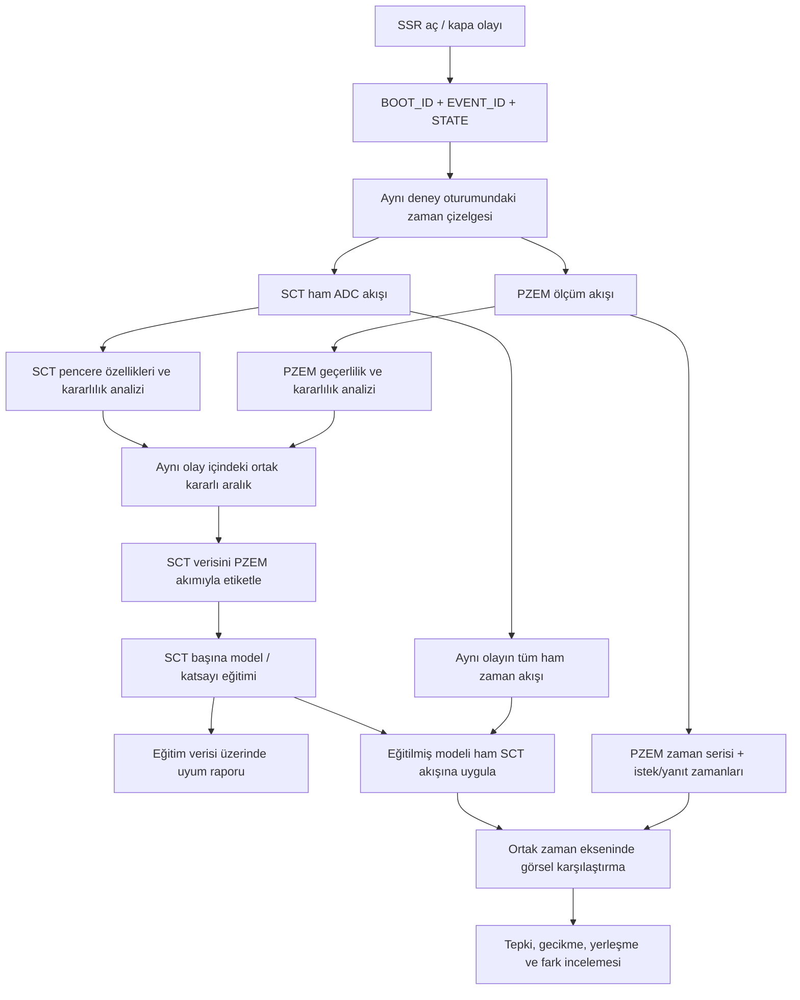
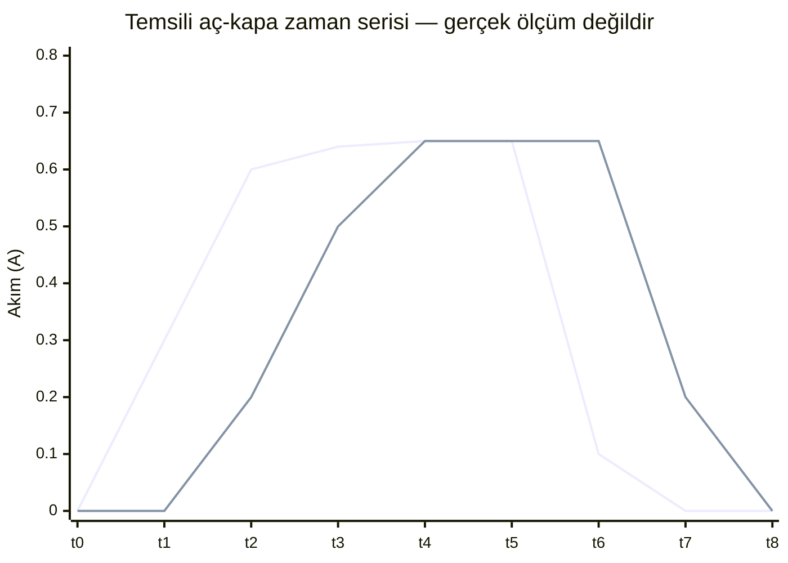

# BERO — Kararlı alan eğitimi ve aç-kapa ham akış gözlemi

**Durum:** Kullanıcı tarafından açıklanan hedef çalışma modeli; plan/dokümantasyon aşamasında. Firmware, Python analiz kodu, model ve fiziksel deney henüz uygulanmış değildir.

## 1. Temel fikir

Aynı SSR aç-kapa deneyi iki ayrı ama bağlantılı amaçla kullanılır:

1. **Öğrenme:** Aç-kapa olayının içinden PZEM ve SCT'nin birlikte kararlı olduğu alanları seçeriz. Bu alanlardaki SCT verisi, geçerli PZEM akımıyla etiketlenir ve model bu veriyle eğitilir.
2. **Zamansal gözlem:** Aynı olayın yalnız kararlı parçalarını değil, açma/kapama geçişleri dahil tüm SCT ham zaman akışını saklar ve modelden geçiririz. Model tahmini ile PZEM akışını ortak zaman ekseninde yan yana inceleriz. Böylece tepki şekli, gecikme, yerleşme ve iki akış arasındaki zaman farkı görünür olur.

Bu iki görünüm aynı deney kaydından çıkar; fakat **aynı soruyu cevaplamaz**. Kararlı alanlar etiket ve model katsayısı öğrenmek içindir. Tam ham akış grafiği ise dinamik davranışı anlamak içindir.

## 2. Veri akışı ve ilişkiler

- SSR olayı, hangi açma/kapama denemesinin incelendiğini söyler; tek başına kararlılık veya etiket anlamına gelmez.
- PZEM ve SCT kararlılığı ayrı ayrı belirlenir. Eğitim etiketi yalnız aynı SSR olayındaki **örtüşen ortak kararlı alandan** üretilir.
- Ham akışın tamamı, geçişler dahil, zamansal inceleme için korunur. Normal arşivleme politikası ve olay tamponu kuralları ayrıca geçerlidir; bu belge sürekli ve sınırsız ham ADC arşivini zorunlu kılmaz.
- Zaman damgaları, monotonik zaman, SSR olay zamanı ve PZEM istek/yanıt zamanları ilişki kurmak içindir. Milisaniye hassasiyetinde her SCT örneğini tek bir PZEM okumasına eşlemek hedef değildir.

## 3. Öğrenme verisi nasıl seçilir?

1. SSR ON veya OFF olayını `BOOT_ID`, `EVENT_ID`, `STATE` ile tanımla.
2. Olay içindeki geçerli PZEM akım kayıtlarını ayır; PZEM'in kararlı alanlarını deneyle belirlenecek ölçütlerle bul.
3. Aynı olay içindeki SCT ham örneklerinden pencere özellikleri çıkar; SCT'nin kararlı alanlarını bağımsız belirle.
4. İki kararlı alanın örtüştüğü ortak aralığı seç. Yalnız bir tarafın kararlı olması yeterli değildir.
5. Ortak aralıkta SCT özelliklerini ilgili geçerli PZEM akımıyla etiketle.
6. ON ve OFF olaylarını, farklı yükleri ve sensörleri kimlikleri korunarak veri kümesine ekle.
7. Seçilen kararlı etiketli veriden SCT başına katsayı veya `f(x)` modeli öğren.

Kararlılık eşikleri, pencere boyları, ardışık pencere sayısı ve özellik seçimi önceden uydurulmaz; deney verisiyle kararlaştırılır. Geçiş alanları eğitim etiketi yapılmaz, ancak dinamik gözlem için ham kayıtta kalır.

## 4. Aynı veride ilk uyum değerlendirmesi

İlk aşamadaki değerlendirme, modelin eğitildiği aynı etiketli kararlı alan verisine yeniden uygulanmasıdır. Geçerli ve sıfırdan farklı PZEM akımı için:

`relative_error = abs(SCT_prediction - PZEM_current) / abs(PZEM_current)`

- `relative_error <= 0.04` → `OK`
- `relative_error > 0.04` → `OUT_OF_RANGE`
- PZEM değeri geçersiz veya sıfırsa yüzde sapma sınıflandırması yapılmaz; durum ayrı tutulur.

Bu rapor **eğitim verisi içi uyumdur**. Bağımsız veri üzerindeki genelleme başarımı veya görülmemiş yüklerde doğruluk kanıtı değildir. Kullanıcının ilk aşama hedefinde ayrı bir holdout/test kümesi kabul şartı yoktur. İleride yeni kayıtlar geldikçe birleşik veri kümesi ve model sürümleri ayrıca karşılaştırılabilir.

## 5. Ham aç-kapa akışında dinamik gözlem

Eğitilmiş model aynı deneyin tam SCT ham akışına uygulanır. Modelin ürettiği SCT akım tahmini, PZEM'in zaman damgalı akım kayıtlarıyla aynı zaman ekseninde çizilir. Açma ve kapama geçişleri grafikte görünür bırakılır.

Aşağıdaki şema yalnız kavramı anlatır; sayılar **temsili örnektir, ölçüm sonucu değildir**.

Grafikteki ilk çizgi SCT model tahmini, ikinci çizgi PZEM akım akışı olarak düşünülmelidir. Gerçek grafikte çizgi adları/renkleri açıkça gösterilecek; zaman noktaları gerçek kayıttan gelecektir.

İncelenecek sorular:
- SSR ON sonrasında SCT tahmini ve PZEM akışı ne zaman değişmeye başlıyor?
- Her akışın gözlenen tepki ve yerleşme süresi nedir?
- SSR OFF sonrasında düşüşün şekli ve gecikmesi nasıldır?
- PZEM güncellemeleri ne sıklıkta geliyor; istek/yanıt süresi ve güncelleme aralığı nasıl değişiyor?
- SCT tahmini ile PZEM arasındaki fark zaman boyunca nasıl değişiyor?
- PZEM'in gecikmesi dikkate alındığında görünen farkın ne kadarı zaman kaymasından, ne kadarı değer farkından kaynaklanıyor olabilir?

### Zaman ve gecikme yorumunda dikkat

PZEM'in yazılıma yanıt verdiği zaman, cihazın iç ölçümünün tam olarak hangi ana ait olduğunu garanti etmez. Bu nedenle en azından SSR olay zamanı, ortak monotonik saat, PZEM istek zamanı, PZEM yanıt zamanı ve SCT örnek/pencere zamanları korunmalıdır. `pzem_response_time - pzem_request_time` yalnız haberleşme/okuma süresini verir; fiziksel ölçüm güncelleme gecikmesinin tamamı olarak adlandırılmamalıdır.

Gecikme; açma ve kapama için ayrı, tekrarlı olaylarda dağılım olarak incelenebilir. Önce gözlenen zaman davranışı raporlanır; PZEM akışını kaydırma veya zaman düzeltmesi ancak kanıt ve açık yöntemle yapılır. Zaman kaydırması kararlı alan etiketlemesinin yerine geçmez.

Bu ham akış grafiği dinamik davranış incelemesidir. PZEM her anda bağımsız ve anlık ground truth olmadığı için, geçiş anlarında iki çizginin ayrılması tek başına modelin hatalı olduğunu kanıtlamaz. Sayısal ±%4 ilk uyum ölçütü, etiketli kararlı alanlardaki eğitim verisi içi karşılaştırmaya uygulanır.

## 6. Raporları ayrı tut

| Rapor | Veri | Cevapladığı soru |
|---|---|---|
| Eğitim verisi içi uyum | Ortak kararlı alanların etiketli SCT özellikleri | Model öğrendiği örneklerle ne kadar uyumlu? |
| Ham aç-kapa zaman grafiği | Aynı olayın tam SCT akışı + PZEM zaman serisi | Model ve PZEM olay boyunca nasıl tepki veriyor? |
| Gecikme/yerleşme incelemesi | SSR, SCT ve PZEM zaman bilgileri | Tepki ve güncelleme zamanları nasıl? |
| Gelecekteki birleşik veri kümesi raporu | Sürümü belirtilmiş tüm etiketli kayıtlar | Model veri kümesi büyüdükçe nasıl değişiyor? |

Bir rapor diğerinin yerine kullanılmaz. Özellikle dinamik grafikteki geçiş farkları eğitim başarım yüzdesine karıştırılmaz.

## 7. İzlenebilirlik için önerilen kayıt alanları

Alan adları nihai şema kararı değildir; uygulama öncesinde mevcut şemayla birleştirilip doğrulanacaktır.

- Olay: `boot_id`, `event_id`, `state`, `ssr_event_time`
- SCT: `sensor_id`, `sample_time` veya pencere başlangıç/bitişi, gerçek örnekleme hızı, ham kayıt referansı, özellikler, clipping/durum bilgisi
- PZEM: `pzem_request_time`, `pzem_response_time`, `pzem_current`, `read_status`
- Etiket/eğitim: `stable_interval_id`, `label_pzem_current`, `label_validity`, `calibration_id`, model sürümü ve kullanılan veri kümesi kimliği
- Gözlem: `sct_prediction`, karşılaştırma zamanı, zaman farkı ve gecikme/yerleşme ölçüm tanımı

Geçersiz PZEM okumaları (sentinel, NaN, timeout, parse hatası) etiket veya yüzde hata hesabına alınmaz. Gerçek sıfır akım, doğrulanmadan geçersiz sayılmaz.

## 8. Proje aşamalarıyla ilişkisi

Bu mimari uzun vadeli hedefi açıklar; mevcut ilk teknik adımı değiştirmez. Aktif sıra E00A ham ADC gözlemi → E00/T005/E01 temel okumalarıdır. E08 SCT karakterizasyonu ayrı olarak yalnız SCT davranışını inceler; PZEM ile ortak etiket üretme veya PZEM gecikmesini ölçme deneyi değildir. PZEM edinimi, olay zamanları, ortak kararlı alan etiketleme ve modelleme uygun sonraki aşamalarda yapılır.

## HEDEF / LOG / SONUÇ

- **HEDEF:** Aynı SSR aç-kapa deneyinden hem ortak kararlı alan eğitim verisi hem de tam ham zaman akışı davranış gözlemi üretilecek mimariyi açıkça tanımlamak.
- **LOG:** Kullanıcı yaklaşımı dokümantasyon düzeyinde netleştirildi. Bu belge hazırlanırken firmware, Python kodu, veri kaydı, model eğitimi veya fiziksel deney çalıştırılmadı.
- **SONUÇ:** Öğrenme ve dinamik gözlem birbirine bağlı fakat ayrı raporlanacak iki iş hattıdır. Uygulama ve deney kanıtı beklenmektedir.
